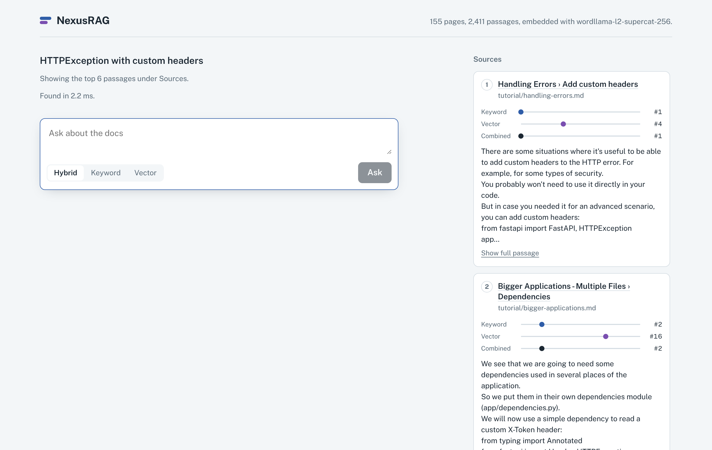

# NexusRAG

**Enterprise-grade hybrid search and document intelligence engine.**

Ask questions about technical documentation and get answers that cite the passages they came from. Retrieval is hybrid (BM25 keyword search plus vector search, fused with Reciprocal Rank Fusion), optionally re-ranked by a cross-encoder. Every number below comes from a benchmark in this repo that you can rerun.

The demo corpus is the FastAPI documentation (155 pages, 2,411 passages). Any folder of Markdown works.



*Search-only mode (no API key), running with the small offline embedder. With a key, the left column streams a cited answer and the numbered citations link to these cards.*

## What it does

- **Hybrid retrieval.** BM25 over a sparse term matrix (sub-millisecond on this corpus) and dense vectors in Qdrant or pgvector, merged by score fusion whose weight was chosen on held-out data (Reciprocal Rank Fusion is also available).
- **Code-aware keyword search.** `HTTPException` is indexed as `httpexception`, `http` and `exception`; `app.include_router` keeps the dotted name and its parts. A query for "http exception" and one pasted from a stack trace both match.
- **Re-ranking.** A second stage re-scores the top candidates with a cross-encoder (BAAI/bge-reranker-base via ONNX, Cohere Rerank, or Claude with a schema-constrained reply).
- **Heading-aware chunking.** Chunks never cross a heading or split a code block, carry their heading path ("Security > OAuth2 with JWT > Hash the password"), and link to the section anchor. mkdocs code includes are inlined so example code is searchable.
- **Context-window management.** Ranked passages are packed into a token budget; adjacent chunks of one page are merged back into continuous text and their overlap removed.
- **Streaming answers over SSE.** Claude answers only from the numbered sources; the stream sends the sources first, then tokens, then a citation check that flags any `[n]` that doesn't match a source.
- **Inspectable ranking.** `/search` and the UI show each passage's rank in keyword search, vector search and the fused list, plus per-stage timings.
- **Operations.** Redis caches search results and enforces a per-client rate limit, and both fail open. Uploads need an admin token. The stack runs with one `docker compose up`.

## Results

Measured on SQuAD v1.1: the fusion weight was chosen on questions about half of the articles, and the results below are on the other **5,173 held-out questions**. CPU only, `BAAI/bge-small-en-v1.5` embeddings.

| Retriever | Hit@1 | Hit@10 | MRR@10 |
|---|---|---|---|
| BM25 keyword search | 0.818 | 0.965 | 0.873 |
| Vector search | 0.689 | 0.940 | 0.780 |
| Hybrid, equal-weight RRF (the common default) | 0.803 | 0.977 | 0.868 |
| **Hybrid, tuned score fusion (NexusRAG default)** | **0.846** | **0.985** | **0.899** |

- The common default, equal-weight RRF, did not beat keyword search on MRR@10.
- The tuned fusion improves MRR@10 by +2.6 points over BM25 (95% CI +2.2 to +3.1) and +11.9 over vectors alone.
- Questions with no relevant passage in the top 10 drop from 3.5% to 1.5%.
- BM25 answers in 0.24 ms (p50) over the 2,411 FastAPI chunks. Query embedding plus vector search takes about 16–24 ms on CPU.
- On 80 FastAPI-docs questions the same setting reaches Hit@10 = 1.000. That set is too small to separate the hybrid from vector search.
- The cross-encoder re-ranker has only been measured on that small set, where it did not help and cost ~10 s per query on CPU. It is off by default.

Full tables, method and caveats: [bench/README.md](bench/README.md). Raw output: [bench/results](bench/results).

## Architecture

```
                 ┌──────────── ingest ────────────┐
 Markdown ──► heading-aware chunker ──► BM25 index (scipy sparse)
                                    └─► embedder ──► Qdrant | pgvector | numpy

 question ──► BM25 top 50 ─┐
          └─► vector top 50 ┴─► score fusion ──► re-rank top 20 (optional) ──► pack into token budget
                                                                           │
                       Next.js UI ◄── SSE: sources → tokens → citations ◄── Claude
```

| Path | What's there |
|---|---|
| `backend/nexusrag/` | chunking, tokenizer, BM25, embedders, vector stores, fusion, re-rankers, context packing, generation, FastAPI app |
| `backend/eval/` | retrieval benchmark, fusion-weight tuning on held-out data, answer-faithfulness eval with Claude as judge, the 80 FastAPI questions |
| `backend/tests/` | 43 tests: unit, API (with fake Redis), all three vector stores, and the real Anthropic SDK against a canned stream |
| `frontend/` | Next.js chat UI with streaming, clickable citations and the retrieval trace |
| `bench/` | benchmark write-up and raw results |

## Run it

With Docker (Qdrant, Redis, API, web):

```bash
export ANTHROPIC_API_KEY=sk-ant-...   # optional: without it you get ranked passages, no generated answer
make up        # fetches the FastAPI docs, builds and starts everything
make ingest    # indexes the docs (first run downloads the embedding model)
open http://localhost:3000
```

Without Docker:

```bash
make data
cd backend && pip install -e ".[dev]"
python -m nexusrag.ingest ../data/fastapi/docs/en/docs --base-url https://fastapi.tiangolo.com \
    --url-style mkdocs --include-root ../data/fastapi/docs_src
uvicorn nexusrag.api:app --port 8000
cd ../frontend && npm ci && npm run dev
```

Index your own docs by pointing `nexusrag.ingest` at any folder of `.md`/`.txt` files, or upload them with `POST /documents` (set `NEXUS_ADMIN_TOKEN`).

## API

| Endpoint | |
|---|---|
| `POST /search` | `{"query", "k", "mode": "hybrid"\|"bm25"\|"dense", "rerank"}` → hits with per-stage ranks and timings |
| `POST /chat` | `{"question", "history", "mode"}` → SSE events `sources`, `token`, `citations`, `done`, `error` |
| `GET /health` | index size, embedder, store, re-ranker, cache status |
| `GET /documents` | indexed documents |
| `POST /documents`, `DELETE /documents/{id}` | add or remove documents (admin token) |

## Configuration

Environment variables with the `NEXUS_` prefix (see `backend/nexusrag/config.py`):

| Variable | Default | |
|---|---|---|
| `NEXUS_EMBEDDER` | `fastembed:BAAI/bge-small-en-v1.5` | also `sentence-transformers:<model>`, or `wordllama` (bundled, fully offline, weaker) |
| `NEXUS_VECTOR_STORE` | `memory` | `qdrant` or `pgvector` |
| `NEXUS_RERANKER` | `none` | `fastembed:BAAI/bge-reranker-base`, `cross-encoder:<model>`, `cohere`, `claude` |
| `NEXUS_FUSION` | `weighted` | `weighted` (normalised scores) or `rrf` (ranks) |
| `NEXUS_DENSE_WEIGHT` | `0.4` | share of the fused score from vectors; retune with `eval/tune_fusion.py` if you change the embedder |
| `NEXUS_CONTEXT_TOKEN_BUDGET` | `6000` | tokens of sources sent to the model |
| `NEXUS_REDIS_URL` | unset | enables caching and rate limiting |
| `ANTHROPIC_API_KEY` | unset | enables `/chat` |

## Reproduce the benchmarks

```bash
make data
make bench           # FastAPI + SQuAD retrieval, fusion tuning, re-ranking (CPU: a few hours on 2 cores)
cd backend && ANTHROPIC_API_KEY=... python eval/run_answers.py --docs ../data/fastapi/docs/en/docs \
    --include-root ../data/fastapi/docs_src --limit 40   # answer faithfulness, ~80 Claude calls
```

## Design notes

- **Why no LangChain or LlamaIndex?** Each stage here is a few dozen lines, and writing them directly is what makes per-stage ranks and timings, and the ablations in `bench/`, straightforward. The embedder, store and re-ranker are interfaces, so a framework component can be dropped in.
- **Retrieved text is untrusted.** Sources are fenced in the prompt with an instruction to treat their contents as data; the Claude re-ranker does the same. Model output is rendered as a token tree, never as HTML.
- **Cache and rate limit fail open.** If Redis is down, requests are slower, not refused.

## License

MIT
